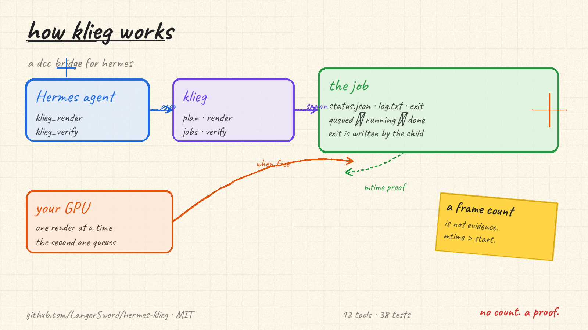

# Klieg

Motion design for Hermes.

Hermes can describe an animation; Klieg gives it hands to actually make one. Author a
scene - kinetic type, a transition, a lower-third, a logo sting, a loop - and Klieg
renders it to MP4/GIF locally, no API keys. The same job engine that drives Blender
survives the wall-clock: detached, logged, and verified by the artefact on disk, not the
exit code. Then it seals what was produced, so you can prove later that nothing drifted.

**[Catalog entry](catalog/klieg.yaml)** · if this is useful, a star helps the next person find it.



*Whiteboard: agent, approval gate, adapter, job directory, verify. 1600x900.*

**[50s launch film](docs/media/klieg_demo.mp4)** — a cinematic explainer, not a screencast:
the stale-frame trap, the artefact rule, the six-stop pipeline, then the ledger seals the
frames and catches a re-touched one. GSAP motion, captions in the picture, an in-repo synth
bed; no AI voice, no terminal.
Rebuild: `python scripts/render_explainer.py` (renders the HTML frame-by-frame, then muxes).
Source: [`docs/explainer/index.html`](docs/explainer/index.html).

## Motion design (the core)

`klieg_motion` turns a scene into a film. Hermes authors a declarative spec (layers,
keyframes, easing), raw HTML+GSAP, or starts from a template:

- `action=templates` - starters: title-reveal, lower-third, kinetic-quote, logo-sting.
- `action=render template=title-reveal params={"word":"KLIEG"} out=clip.mp4` - compiles
  the scene and renders it frame-by-frame to MP4/GIF as a detached job; poll with
  `klieg_jobs`, confirm with `verify`.
- `action=preview ... t=2.5` - render one frame to iterate cheaply before a full render.

Effects: fade, rise, drop, slide, scale, pop, blur, spin. Easing: expo / power / back /
elastic. Text splits into chars or words for staggered kinetic type. Backgrounds: solid,
gradient, grain, vignette. Output: 1080p, square, or vertical for social.

Needs `playwright` + a chromium headless shell in the render interpreter (point
`KLIEG_PYTHON` at it). Rendering is deterministic - every frame is fully painted, so
motion is smooth with no screencast frame-drops.

## Six decisions

**1. A job is done only when its artefact is newer than the job start.**
`klieg_jobs action=verify` compares each expected file with the job start time. It also
counts the frames. A render that stops at frame 3 of 288 fails. A render that emits 288
frames from a scene that did not rebuild fails.

**2. Plan costs nothing.**
`klieg_plan` returns the argv, the expected files, a predicted duration, and the blockers.
It does not start a render and it writes nothing. Check a weak model in one call, before it
spends an hour.

**3. One GPU, one render.**
`klieg_render` takes a lock for each host. A second render enters the queue and reports its
position in that host's queue. `queue=false` refuses. Killing the holder hands the GPU to
the next queued job immediately.

**4. Approval is per action.**
Verbs that execute code, spend GPU time, or overwrite deliverables send an approval
request. Read-only actions of a mixed tool do not: `klieg_session status/list/colour`,
`klieg_colour probe/compare/tags`, built-in `klieg_gate gate=...`, `klieg_ledger
check/show`. Unattended runs fail closed.

**5. Colour is a record, not a tag.**
`klieg_colour action=write` stores the view transform, the look, the exposure, and the
sha256 of the OCIO config in `colour_manifest.json`. `action=compare` reports each field
that changed. A different view transform gives a different film.

**6. Provenance is a hash, not a claim.**
`klieg_ledger action=seal` hashes the scene, the script, every frame, the colour manifest
and the encode into a ledger; `action=check` re-hashes and reports every changed, missing
or added file. "These exact frames came from this exact scene" becomes checkable.

## Tools

| tool | use |
|---|---|
| `klieg_motion` | **author + render 2D motion design**: scenes/templates -> MP4/GIF, preview a frame |
| `klieg_probe` | list the hosts on this machine and their versions |
| `klieg_plan` | resolve a render without running it (writes nothing) |
| `klieg_scene` | read the engine, resolution, frame range, view transform, and object count |
| `klieg_run` | run a script in a host; detach it when it is long |
| `klieg_render` | render a frame range as a job that queues behind the GPU holder |
| `klieg_track` | run a projection script and confirm the file it wrote |
| `klieg_gate` | built-in gates over frames (flash, loop, stats, safe_band), or a DCC script that prints `KLIIEG_GATE {json}` |
| `klieg_jobs` | list, queue, status, log, verify, kill |
| `klieg_publish` | encode frames with BT.709 conversion and colour tags; mid-sequence and gapped frame sets included |
| `klieg_session` | open a socket to a running Blender, run code, read colour state, stop |
| `klieg_colour` | write, compare, or check a colour manifest |
| `klieg_taste` | record verdicts, train a preference (held-out accuracy), score a frame |
| `klieg_ledger` | seal a finished job's provenance; check it for drift; show the seal |

### Built-in gates

`klieg_gate gate=<name> frames_dir=<dir>` measures any numbered PNG sequence with
numpy/Pillow — no DCC, no model-authored code, no approval prompt:

- **flash** — full-field luminance transitions per second, against the 3-flashes/s
  photosensitivity guideline. An approximation, explicitly not a certified Harding test.
- **loop** — first-vs-last frame difference and changed bbox: does the sequence close?
- **stats** — per-frame exposure/clipping, temporal stability, exposure drift.
- **safe_band** — worst-frame detail (edge energy) inside platform UI margins.

## Run it

```sh
git clone https://github.com/LangerSword/hermes-klieg ~/.hermes/plugins/klieg
hermes plugins enable klieg
# Start a new session. Then list the hosts:
klieg_probe

# Proof 1: render two frames, verify them, encode them.
python3 scripts/e2e.py

# Proof 2: start a real Blender and drive it over a socket.
python3 scripts/test_bridge.py

# The test suite. No Blender and no GPU are necessary; numpy/Pillow optional
# (pixel tests skip cleanly without them).
python3 -m unittest discover -s tests
```

Blender finds its Python library from the first `python3` on `PATH`. A pyenv or conda entry
breaks that lookup. Run Blender with `PATH=/usr/bin:/bin`.

## Evidence

| check | command | result |
|---|---|---|
| tests (deps installed) | `python3 -W error::ResourceWarning -m unittest discover -s tests` | 158 tests, OK (1 skip) |
| tests (bare stdlib) | same, without numpy/Pillow/playwright | 158 tests, OK (26 skips) |
| motion, live | `klieg_cli.py motion render --template title-reveal …` | title-reveal rendered to a verified 1080p MP4 |
| live bridge | `python3 scripts/test_bridge.py` | 10 of 10 checks on Blender 5.3.0; supports 4.2+ |
| end to end | `python3 scripts/e2e.py` | frames 1-2 rendered, verified, encoded, 5,573 bytes |
| ledger, live | `klieg_cli.py ledger seal/check --job e2e-…` | sealed, `intact: true` |
| gates, live | `klieg_cli.py gate loop/stats/flash --frames …` | loop closed at 0.0 diff; 0 flashes/s |
| plugin admission | `hermes plugins validate .` | validation passed |
| registration | `hermes plugins doctor .` | 14 tools, 1 hook |
| served surface | `python3 smoke_load.py` | load + register + hook/handler dispatch, LOAD SMOKE OK (stdlib only) |

`VERIFICATION.md` gives each check with its output, and each claim that is not verified.

## Limits

- This repository includes the GUI add-on. The tests do not cover it. This machine had no
  interactive Blender. The headless server uses the same protocol, and it passes the bridge test.
- The live bridge supports Blender only. Houdini, Nuke, and After Effects need their own
  protocols.
- The taste model has no real verdicts. It refuses to score below 12 verdicts, and reports
  held-out accuracy once trained. Pillow loads Blender's 16-bit RGBA PNGs as 8-bit; taste
  features are computed on those 8-bit samples (16-bit grayscale is scaled correctly).
- `klieg_publish` has encoded two frames, not a full film.
- The flash gate is a screening approximation, not a certification.
- The ledger detects drift; it is not a signature. Anyone who can edit the files can edit
  the ledger.
- `klieg_motion` needs playwright + a chromium headless shell; without them, render/preview
  report the missing dependency as data (the compiler and templates still work).

## Security

Read `SECURITY.md` before you install.

- Children get a 13-variable environment allow-list.
- Klieg drops any name that matches KEY, TOKEN, SECRET, or PASSWORD. It records the drop.
- `klieg_publish` and `klieg_colour write` refuse to write under `/etc`, `/usr`, `~/.ssh`,
  and `~/.aws`.
- Klieg is not a sandbox. An approved script is arbitrary code.

## Stack

| component | role |
|---|---|
| Python 3.10+ standard library | the plugin, the job engine, the socket client, the ledger, the motion compiler |
| numpy, Pillow | `klieg_taste` features/scoring and the built-in gates; declared in `plugin.yaml`, imported on demand |
| playwright + chromium headless shell | `klieg_motion` frame rendering; optional, set `KLIEG_PYTHON` to an interpreter that has it |
| Blender 4.2 or later | the render host; `klieg_colour` reads display_device from `display_settings` (4.2-compatible path, tested against a fake 4.2 bpy) |
| ffmpeg | encode, colour tags, probe |
| POSIX unix socket | the live bridge; no TCP port |

## Layout

```
plugin.yaml           manifest: 14 tools
klieg_core.py         jobs, queue, history, locks, verify
klieg_adapters.py     six hosts, one interface
klieg_tools.py        the verbs
klieg_hooks.py        per-action approval policy
klieg_bridge.py       unix socket client
klieg_colour.py       manifest, diff, tag check
klieg_taste.py        features, verdicts, held-out model
klieg_ledger.py       provenance: seal, check, show
klieg_gates.py        flash, loop, stats, safe_band
klieg_motion.py       motion compiler + templates (the authoring core)
blender/              headless server and GUI add-on
scripts/              cli, motion_render, e2e, bridge test, explainer, qa
tests/                158 cases, hermetic
```

MIT. The whiteboard, the demo, and the sample frames in this repository come from the
scripts in `scripts/`.